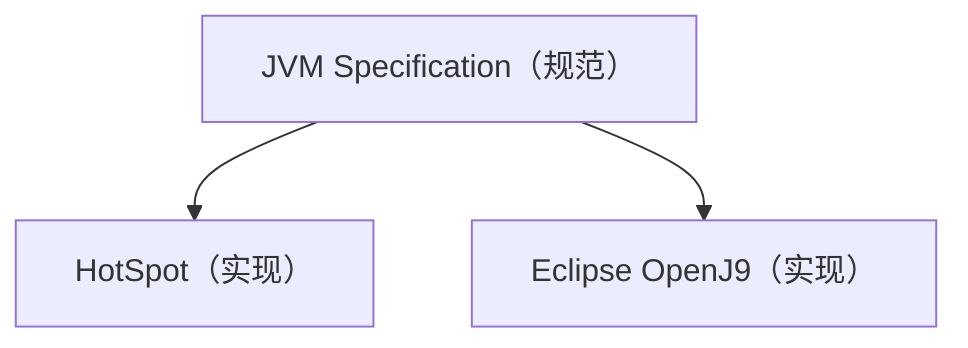
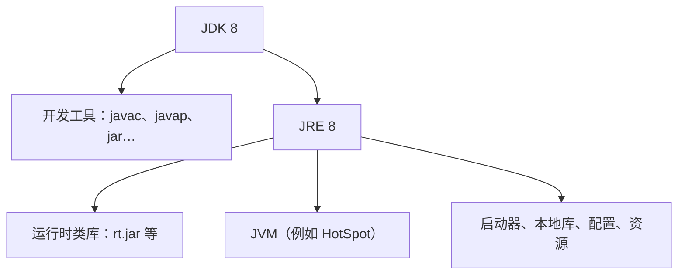
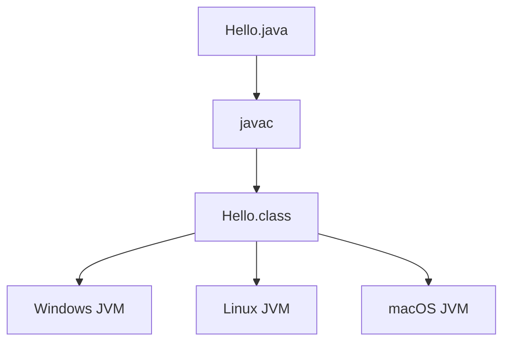

# 1.1 完整理论讲义

## 1. 技术背景与学习目标

在 JDK 8 时代，常见公式为 JDK = JRE + 开发工具，JRE = JVM + 核心类库。这是对传统产品结构的简化理解，不能机械套用于现代模块化镜像。本节从既有 JDK 8 经验出发，解释 Java SE 标准、JDK 产品、JRE 运行环境、JVM 规范与实现的关系，以及现代部署方式。

## 2. 四个核心概念

### 2.1 Java SE

Java Platform, Standard Edition 是标准 Java 平台。其规范体系包括 Java Language Specification (JLS，语言语法及语义)、Java Virtual Machine Specification (JVMS，Class 格式、字节码及虚拟机行为)、Java SE API Specification（标准类库行为）等。JDK 提供具体实现以及开发工具，还可能有 Java SE 以外的 JDK 专属 API。

例如：

```java
List<String> names = new ArrayList<>();
names.add("Java");
names.add("Python");
```

List、ArrayList 是 Java SE API；规范规定其行为，具体 JDK 提供实现。以上片段需导入 java.util.List 与 java.util.ArrayList 并放入方法体。

### 2.2 JVM

Java Virtual Machine 有两个语境：抽象虚拟机的规范，以及具体运行软件。规范定义 Class 文件、字节码指令、运行时数据区、加载与执行等；HotSpot 与 Eclipse OpenJ9 是不同的具体实现。JIT、GC 策略、对象头和实现内部结构不由规范强制统一。HotSpot 只是 JVM 的一种实现，不能将 HotSpot 中的 G1、ZGC、C1/C2、Metaspace 等实现概念等同于 JVM 规范。



### 2.3 JRE

Java Runtime Environment 提供运行所需的 JVM、运行时类库、java 启动器、本地库、配置及资源。运行已编译应用（如 java -jar app.jar）通常不需要 javac。传统生产服务器因此可以只安装 JRE；具体应用仍必须具有全部运行依赖。

### 2.4 JDK

Java Development Kit 提供运行能力与编译、打包、诊断等工具。常用工具：

| 工具 | 作用 |
| --- | --- |
| java | 启动程序 |
| javac | 编译源码 |
| javap | 查看 Class 文件及反汇编 |
| jar | 管理 JAR |
| javadoc | 生成 API 文档 |
| jdb | 调试 |
| jcmd | JVM 诊断 |
| jstack | 线程堆栈 |
| jmap | 内存诊断 |
| jshell（9+） | 交互式编程 |
| jdeps（8+） | 依赖分析 |
| jdeprscan（9+） | 废弃 API 扫描 |
| jlink（9+） | 定制运行时 |
| jpackage（16 正式） | 应用打包 |
| jfr（12+） | JFR 文件分析 |

## 3. JDK 8 与现代 JDK

### 3.1 JDK 8 传统包含结构



典型目录（发行版、平台不同可能存在差异）：

```text
jdk1.8.0_xxx/
├── bin/            # java、javac、javap、jar 等
├── include/
├── lib/
│   └── tools.jar
├── jre/
│   ├── bin/java
│   └── lib/
│       ├── rt.jar
│       ├── ext/
│       └── security/
└── src.zip
```

rt.jar 存放大量核心类（如 String、Object、ArrayList、HashMap），tools.jar 存放开发工具相关类。JRE 不等于单独的 JVM。

### 3.2 JDK 9 模块化运行时（JEP 220、261、282）

Java 平台模块系统（JPMS）将平台按职责划分。java.base 提供基础语言、集合与 IO；java.sql 提供 JDBC；java.desktop 提供 AWT/Swing；java.logging、java.xml 等提供各自功能。

JDK 9 起不再在 JDK 内嵌 jre/ 镜像，不再有 rt.jar、tools.jar、lib/ext 扩展机制；JDK/JRE 镜像采用同样的模块化目录形式。模块资源可通过 jrt:/ URI 访问。jlink 支持链接指定模块及其传递依赖构建运行时。模块与包是不同概念，一个模块可包含多个包。

### 3.3 JDK 11 Oracle JRE 分发变化

| 版本 | JDK 内嵌 jre/ | Oracle 独立 JRE 下载（该主版本） |
| --- | --- | --- |
| 8 | 是 | 是 |
| 9、10 | 否 | 是 |
| 11、17、21、25 | 否 | 否 |

JDK 9 改变运行时结构；JDK 11 改变 Oracle 的分发方式，不代表 Java 运行时概念消失，也不代表所有发行商停止提供 JRE。Eclipse Temurin 等仍提供 JRE 选项（依平台和版本而定）。

### 3.4 现代 JDK 25 结构

```text
jdk-25/
├── bin/           # java、javac、javap、jlink、jpackage
├── conf/
│   └── security/
├── include/
├── jmods/
│   ├── java.base.jmod
│   ├── java.sql.jmod
│   ├── java.net.http.jmod
│   └── jdk.compiler.jmod
├── legal/
├── lib/
│   ├── modules
│   └── src.zip
└── release
```

- bin：启动器和工具；conf：可配置文件；include：本地开发头文件。
- jmods：模块文件，供 jlink 等工具使用；lib/modules：常见运行时内部模块镜像，并非普通 JAR。
- lib/src.zip：源代码归档（某些发行版可能缺少或采用其他布局）；legal：许可；release：发行信息。
- JVM 与本地库仍存在，模块化运行时包含所需平台模块和工具模块（完整 JDK 例如 jdk.compiler、jdk.jlink、jdk.jfr）。macOS 的 JDK 根目录通常为 Contents/Home。
- 具体文件布局因系统、发行版、构建方式而异；不要依赖私有内部文件格式。

## 4. Java 程序运行及跨平台



javac 把 Java 源码编译为符合 JVMS 的 Class 文件，具体 JVM 通过类加载、链接、初始化与执行机制运行程序（解释执行、JIT 等属于实现策略）。字节码不绑定特定 CPU/OS，但 JDK 和 JVM 本地二进制通常绑定 OS、CPU 架构和 ABI。

跨平台条件：运行时 Class 格式及 API 兼容、依赖可用、路径/文件系统/字符编码/时区/字体差异已处理；JNI/本地 DLL/SO、外部命令或硬编码 Windows 路径可能破坏可移植性。不能将 Windows x64 JDK 直接复制到 macOS ARM64 执行。

## 5. 字节码兼容性

Java 8～27 的普通 Class 文件主版本号如下（主版本号不是 Java 运行时补丁号）：

| JDK | major | JDK | major |
| --- | ---: | --- | ---: |
| 8 | 52 | 18 | 62 |
| 9 | 53 | 19 | 63 |
| 10 | 54 | 20 | 64 |
| 11 | 55 | 21 | 65 |
| 12 | 56 | 22 | 66 |
| 13 | 57 | 23 | 67 |
| 14 | 58 | 24 | 68 |
| 15 | 59 | 25 | 69 |
| 16 | 60 | 26 | 70 |
| 17 | 61 | 27 | 71 |

普通 Java 8–27 Class 主版本 = Java 主版本 + 44。低版本 JVM 加载更高版本 Class 时会出现 UnsupportedClassVersionError；高版本一般可以加载较低版本的普通 Class 文件，但并不保证应用 API、第三方依赖或行为兼容。使用预览特性的 Class 有额外版本及 --enable-preview 限制，不能跨 JDK 主版本直接运行。

原课程交互实验转换为静态对照：

| 编译目标 | 运行环境 | 预期主版本检查 |
| --- | --- | --- |
| 25（69） | 8（最高 52） | 不通过 |
| 8（52） | 25（最高 69） | 通过主版本检查，不保证整个应用兼容 |
| 21（65） | 17（最高 61） | 不通过 |
| 17（61） | 17（最高 61） | 通过主版本检查 |

例如在 JDK 25 默认 javac 编译后拿到 JDK 8 运行，可能看到错误中包含 class file version 69.0、runtime only recognizes class file versions up to 52.0；错误文本因发行版而异。--release 同时约束语言、目标 Class 与相应的公开平台 API，详细实验见第 02 章。

## 6. 动手实验与代码

本节实验独立保存：[实验 1 环境属性、实验 2 运行时资源、实验 3 自定义运行时、补充字节码实验](experiments.md)。核心结论：

- JDK 8 的 java.home 通常指向内嵌 jre，现代 JDK 通常指向运行时根目录；不应在现代环境中用 System.getProperty("java.home") + "/.." 假定 JDK 路径。
- String.class 的资源地址通常由 jar:file:.../rt.jar!/... 转为 jrt:/java.base/...，旧的工具不能依赖 rt.jar 扫描标准库。
- jlink 只链接所需模块及其依赖，生成带 JVM、启动器及本地组件的可执行镜像，不要求完整编译器工具。
- 裁剪镜像可能遗漏反射、服务加载或第三方库所需模块，需要验证并维护安全补丁。

## 7. 实际应用与部署

假设两个后端服务：传统方式共用服务器上 JRE；另一种现代方式是各自携带运行时或容器镜像。容器与专属运行时并不是现代 Java 的强制要求。

| 维度 | 共享运行时 | 应用专属运行时 |
| --- | --- | --- |
| 版本 | 可能共用 | 独立选择 |
| 升级 | 可能影响多个服务 | 一般影响当前应用 |
| 环境一致性 | 依赖服务器配置 | 更易固定 |
| 大小 | 通常完整运行时 | 可按需裁剪 |
| 安全更新 | 集中维护 | 每个镜像需维护 |
| 分发 | 安装环境再运行 | 随应用/镜像交付 |

现代 Java 可用完整 JDK、供应商 JRE 或自定义运行时。选型依据应用依赖、诊断、镜像大小、维护能力和安全策略。容器隔离不等同于虚拟机，也不免除 JDK 更新责任。

## 8. 常见误区

| 误区 | 正确理解 |
| --- | --- |
| Java SE 就是 JDK | 标准平台与实现工具包不同 |
| JVM 就是 HotSpot | HotSpot 是一种实现 |
| JDK 9 起没有 JRE | 变化的是运行时组织形式 |
| JDK 11 起没有运行环境 | Oracle 的独立 JRE 分发变化，运行能力仍在 |
| 所有发行商停止提供 JRE | 发行商和平台不同 |
| rt.jar 在 11 才移除 | 9 已移除 |
| 现代 JDK 不需要 JVM | JVM 是核心 |
| 字节码跨平台所以 JDK 二进制跨平台 | OS/CPU 约束不同 |
| JDK 25 能运行所有 JDK 8 项目 | API、依赖与行为需回归 |
| 生产服务器必须安装完整 JDK | 满足应用需求的独立运行时也可以 |

## 9. 知识总结

Java SE 定义标准；JDK 提供平台实现与工具；JRE/运行时镜像提供执行环境；JVM 执行符合规范的程序。这是职责关系，不是现代文件目录嵌套公式。

记住 8（传统 rt.jar / 内嵌 JRE）、9（模块化、jlink）、11（Oracle 独立 JRE 分发改变）三个关键节点。完成 [实验](experiments.md) 和 [课后练习](exercises.md)，再参照 [答案](solutions.md) 验收。官方出处见 [references.md](references.md)。
