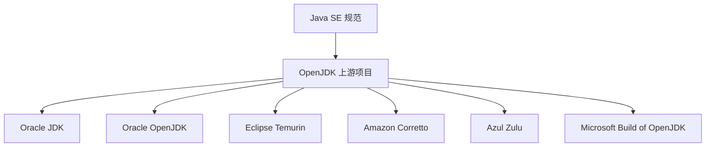

# 1.2 Oracle JDK 与 OpenJDK 完整讲义

## 1. 目标、背景与演进

第 1.1 节区分 Java SE、JDK、JRE、JVM；本节区分平台标准、源代码项目、发行产品、许可证及商业支持。JDK 8 工作基线，JDK 25 学习目标；JDK 11、17、21 用于对照。P0，建议 60–90 分钟。本节不是独立 JEP 特性，JEP 328 是历史例子；第 1.3 节细讲 LTS，第 1.6 节细讲授权与选型。

1995 Sun 推出 Java；2006 开始开源，2007 形成 OpenJDK 源码项目；2010 Oracle 收购 Sun；2017 JDK 9 起 Oracle 提供 GPLv2+CPE 的 OpenJDK 二进制；2018 JDK 11 两类构建进一步趋同。JFR 曾是 Oracle JDK 商业功能之一，JEP 328 使其进入开源 JDK 11。不能照搬 JDK 8 时代的产品区别。

## 2. OpenJDK 项目与发行版

Java SE 是标准平台；OpenJDK 是开发及维护开放实现的项目与社区，包含 HotSpot、javac、类库与工具。发行商选择源码、补丁、构建配置、平台适配、测试、签名及打包，提供二进制和更新。不是所有带 OpenJDK 名称的任意构建都自动获得认证或支持。



示意为共同上游，并非所有构建逐字节相同。可类比 Linux 上游组件及不同发行版，但两者组件边界不同。

| 比较项 | Oracle JDK | Oracle OpenJDK |
| --- | --- | --- |
| 提供者 | Oracle | Oracle |
| 核心代码 | 基于 OpenJDK | 基于 OpenJDK |
| 下载 | oracle.com | jdk.java.net |
| 授权 | NFTC、OTN 等随具体版本而异 | GPLv2+CPE |
| 更新 | Oracle 产品支持策略 | 对应构建发布策略 |
| 商业支持 | 可另行取得合同 | 不自动附带 Oracle JDK 商业支持 |
| 打包 | 安装器及归档等 | 主要归档文件 |

JDK 11 起技术趋同，仍可能有安装、配置、补丁与支持差异。不要把 Oracle JDK 等同于 Oracle OpenJDK，也不要把 OpenJDK 项目等同于某一家发行商。

## 3. GPLv2 + Classpath Exception

OpenJDK 主要代码采用 GPLv2，并对指定代码适用 Classpath Exception（CPE）。GPLv2 对分发受 GPL 覆盖的软件及衍生作品规定义务；CPE 允许与独立模块链接而不因此强制独立模块采用 GPL。用标准类库开发独立 Spring Boot/MyBatis 业务程序，并不会仅因使用 OpenJDK 就要求公开业务源码。

| 场景 | 原则 |
| --- | --- |
| 编译、运行独立业务应用 | 不因此要求公开业务源码 |
| 修改 JDK 仅内部使用 | GPLv2 通常不要求因内部使用公开源码 |
| 分发修改后的 JDK | 履行适用 GPL 源码提供等义务 |
| 随软件分发 JDK/容器/定制运行时 | 遵守实际二进制 LICENSE、NOTICE、第三方授权及源码提供要求 |

CPE 不是取消 GPL 义务；业务程序依赖其他库也有各自许可证。实际分发由法务按具体包和合同审核。

## 4. Oracle JDK 授权与时间线（2026-11-27）

BCL 是历史二进制授权，具体用途、商业组件等有约束；OTN (Oracle Technology Network License Agreement for Oracle Java SE) 允许个人、开发、测试、原型、演示及符合条款的 Oracle 产品/OCI 等用途，普通企业内部生产通常需要额外授权；NFTC (Oracle No-Fee Terms and Conditions) 允许符合条件的免费内部商业及生产使用。NFTC 不等于开源：未修改程序的再分发受条件约束，不可假定收费捆绑分发被允许。

| 产品 | 授权节点 |
| --- | --- |
| Oracle JDK 8 | 2019-04-16 的 8u211/212 等更新起 OTN；更早 BCL 按实际条款 |
| Oracle JDK 11 | Oracle JDK 产品的普通生产用途需按受限授权审查 |
| Oracle JDK 17 | NFTC 更新截至 2024-09；17.0.13（2024-10-15）起 OTN |
| Oracle JDK 21 | NFTC 更新截至 2026-09；21.0.13（2026-10-20）起 OTN |
| Oracle JDK 25 | 当前 NFTC；截至 2028-09 的更新计划采用 NFTC，之后计划 OTN |
| Oracle OpenJDK 9+ | GPLv2+CPE，不套用 Oracle JDK NFTC 切换日期 |

2026-10-20 的 21.0.13 发布说明确认授权已切换，不仅是未来计划。旧 NFTC 发行并不会仅因新更新改变授权而自动变为收费，但应及时修补漏洞，避免冻结在旧版本。OTN 有限定免费用途和其他合同授权，不能说所有情形都收费。Oracle 商业支持时间线与免费授权期不同，也不等于上游/其他发行商的维护期限。

判断顺序：发行商及产品 → 完整版本/补丁 → 实际许可证与合同 → 用途（学习、内部生产、对外分发）→ 更新及支持政策。不要只看主版本。免费生产使用不自动包含 SLA，收费产品不自动保证性能更好。

## 5. 发行版与兼容性

| 发行版 | 特点 | 支持注意事项 |
| --- | --- | --- |
| Eclipse Temurin | Adoptium 开源构建，TCK 与 AQAvit | 社区支持；商业 SLA 另找服务商 |
| Amazon Corretto | 免费生产构建，TCK | 维护与 AWS 支持计划分别判断，可用于非 AWS |
| Azul Zulu | 免费 CA 构建，TCK；另有商业方案 | 核对具体构建及支持合同 |
| Microsoft Build of OpenJDK | 免费构建，LTS TCK | Java 8 在相关 Azure 场景使用 Temurin；核对具体平台与支持范围 |
| Oracle OpenJDK | Oracle GPLv2+CPE 构建 | 不等同于 Oracle JDK 商业长期支持 |

TCK（Technology Compatibility Kit）验证 Java SE 规范符合性，AQAvit 是另外的质量验证体系。规范相同不保证每一实现细节相同。补丁、编译构建选项、GC、信任库、安全提供者、字体、本地依赖及 CPU/OS 支持可能不同。TCK 不证明性能完全一样，更不替代业务回归。

```java
List<String> list = new ArrayList<>();
list.add("Java");
System.out.println(list.size());
```

标准 API 的契约应一致（片段需要 import java.util.* 及方法体）。完整 JDK 8 兼容示例见 examples/JdkIdentity.java。通过 java -version、系统属性及实际安装包来源识别环境；供应商字段不是许可证证明。

## 6. 企业部署及选型

针对旧 JDK 8 的 Spring Boot/MyBatis 服务，假设当前 Oracle JDK 8：如果目标是降低授权风险，可以先评估同主版本、最新安全更新的 Temurin 8 或 Corretto 8，再独立推进 8→21/25；也可直接迁移，但需要控制同时发生的变更。先确认实际安装包、企业合同、框架/驱动/Agent/JNI 支持；运行原有应用做回归；测试 TLS、证书、编码、GC、监控、性能；保留回滚版本。不能以 TCK 或同主版本保证零风险。

推荐本课程采用 Temurin 25 作为主要学习发行版，Temurin 8 作基线，必要时使用 17/21 比较；无需先切换公司环境。Oracle JDK 25 也是当前可用候选，但须关注后续许可计划。企业选型按安全补丁周期、平台、许可证、兼容性、供应链、SLA、成本和既有合规要求评估，不预设唯一最优。第 41–44 章深入迁移；第 1.6 节深入发行版和授权。

## 7. 常见误区与总结

- OpenJDK 不是只有 Oracle 提供的二进制。
- Oracle JDK 不总是收费；Oracle OpenJDK 不等于 Oracle JDK。
- Java 21 不等于 Oracle JDK 21；授权切换不影响所有其他发行版。
- 免费使用不等于开源、不等于免费商业支持。
- GPLv2+CPE 不要求独立业务应用仅因使用标准类库而开源。
- TCK 不保证性能、内部实现或实际应用无差异。
- java.vendor / java.version 只是识别线索，不足以证明企业授权合规。

核心模型：标准 → 上游实现 → 发行构建 → 实际许可证 → 更新与支持。先识别产品再判断授权，先验证应用再替换生产环境。

## 8. 实验、练习与验收

见 [实验](experiments.md)、[课后题](exercises.md)、[参考答案](solutions.md)、[官方资料](references.md)。代码及命令未实测，输出为预期。课程不涉及独立 JEP 新 API，相关 JFR 历史在第 36 章继续核验。
